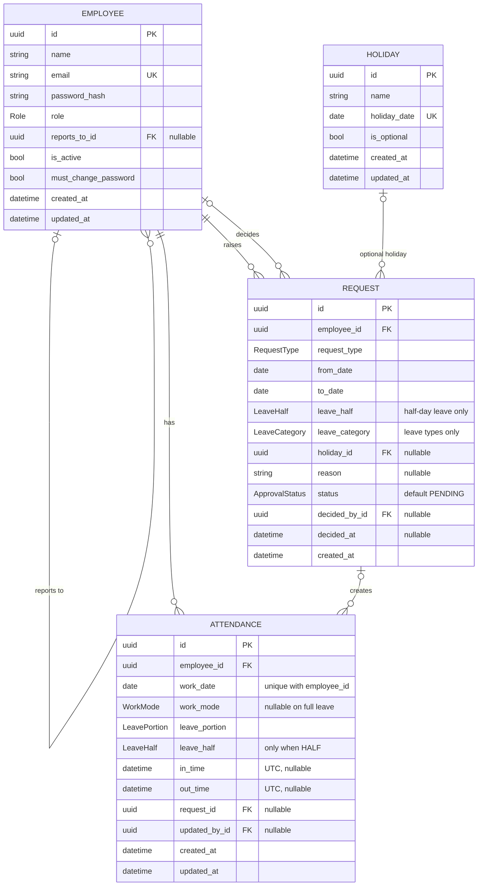

# Database schema

Source of truth for the data model. Update this file in the same pull request as any model or migration change.

GitHub renders the diagram below automatically.

## Tables

### employee

| Field | Type | Rules |
|---|---|---|
| id | uuid | primary key, generated in Python (uuid4) |
| name | string | required |
| email | string | required, unique, stored lowercase |
| password_hash | string | bcrypt hash, never the plain password |
| role | Role | default EMPLOYEE |
| reports_to_id | uuid → employee.id | nullable; empty until managers exist |
| is_active | bool | default true; inactive users cannot sign in |
| must_change_password | bool | true after HR creates the account |
| created_at | datetime (UTC) | set on insert (database default) |
| updated_at | datetime (UTC) | set on insert and on every ORM update |

### attendance

One row per employee per day. Records what actually happened.

| Field | Type | Rules |
|---|---|---|
| id | uuid | primary key, generated in Python (uuid4) |
| employee_id | uuid → employee.id | required |
| work_date | date | required; unique together with employee_id |
| work_mode | WorkMode | nullable only when leave_portion = FULL |
| leave_portion | LeavePortion | default NONE |
| leave_half | LeaveHalf | required when leave_portion = HALF, otherwise empty |
| in_time | datetime (UTC) | nullable (leave day, or not checked in yet) |
| out_time | datetime (UTC) | nullable; must be after in_time |
| request_id | uuid → request.id | nullable; the approved request that set this day |
| updated_by_id | uuid → employee.id | nullable; last person who edited (e.g. HR correction) |
| created_at | datetime (UTC) | set on insert (database default) |
| updated_at | datetime (UTC) | set on insert and on every ORM update |

Not stored: **is_late** is calculated from `in_time` (late after OFFICE_START + LATE_BUFFER_MIN, i.e. 11:00 Asia/Kolkata).

### request

What was asked for and the decision. Covers leave and WFH.

| Field | Type | Rules |
|---|---|---|
| id | uuid | primary key, generated in Python (uuid4) |
| employee_id | uuid → employee.id | who asked |
| request_type | RequestType | required |
| from_date / to_date | date | to_date ≥ from_date; weekends and holidays skipped |
| leave_half | LeaveHalf | required for HALF_DAY_LEAVE and HALF_LEAVE_HALF_WFH |
| leave_category | LeaveCategory | required for leave types, empty for WFH types |
| holiday_id | uuid → holiday.id | only when leave_category = OPTIONAL_HOLIDAY |
| reason | string | optional for every request type |
| status | ApprovalStatus | default PENDING |
| decided_by_id | uuid → employee.id | who approved or rejected: the requester's manager or HR, never the requester (checked in the app by `can_decide()`, not by the FK) |
| decided_at | datetime (UTC) | when decided |
| created_at | datetime (UTC) | used for the "apply 1 day in advance" rule |

### holiday

| Field | Type | Rules |
|---|---|---|
| id | uuid | primary key, generated in Python (uuid4) |
| name | string | required |
| holiday_date | date | unique |
| is_optional | bool | default false; optional holidays are taken through a request |
| is_active | bool | default true; false = removed by HR (soft delete), skipped by every holiday query |
| created_at | datetime (UTC) | set on insert (database default) |
| updated_at | datetime (UTC) | set on insert and on every ORM update |

### email_log

One row per email the app tried to send. The body is not stored (it can be rebuilt from the template, and some emails contain a temporary password).

| Field | Type | Rules |
|---|---|---|
| id | uuid | primary key, generated in Python (uuid4) |
| employee_id | uuid → employee.id | nullable (emails not about one employee); indexed |
| kind | EmailKind | which email |
| work_date | date | nullable; the Pune day the email is about. Required for CHECK_IN_REMINDER |
| to_address | string | the address used at the time |
| subject | string | |
| status | EmailStatus | SENT, FAILED or SKIPPED (sending disabled) |
| error | string | nullable; exception message when FAILED |
| created_at | datetime (UTC) | when it was sent or attempted |
| updated_at | datetime (UTC) | set on insert and on every ORM update |

Unique on (employee_id, kind, work_date) **except FAILED rows** (partial index `uq_email_log_once`): a cron job that runs twice cannot email someone twice, while a failed send can be retried and every failure stays in the history.

## Enums

| Enum | Values |
|---|---|
| Role | EMPLOYEE, MANAGER, HR |
| WorkMode | OFFICE, WFH, HYBRID |
| LeavePortion | NONE, HALF, FULL |
| LeaveHalf | FIRST_HALF, SECOND_HALF |
| RequestType | FULL_LEAVE, HALF_DAY_LEAVE, HALF_LEAVE_HALF_WFH, HALF_WFH, FULL_WFH |
| LeaveCategory | CASUAL, SICK, EARNED, OPTIONAL_HOLIDAY |
| ApprovalStatus | PENDING, APPROVED, REJECTED |
| EmailKind | CHECK_IN_REMINDER |
| EmailStatus | SENT, FAILED, SKIPPED |

## How a request maps to attendance

| Day | leave_portion | leave_half | work_mode | Counts towards WFH limit |
|---|---|---|---|---|
| Normal office day | NONE | — | OFFICE | 0 |
| FULL_WFH | NONE | — | WFH | 1 |
| HALF_WFH | NONE | — | HYBRID | 0.5 |
| HALF_DAY_LEAVE | HALF | FIRST or SECOND | OFFICE | 0 |
| HALF_LEAVE_HALF_WFH | HALF | FIRST or SECOND | WFH | 0.5 |
| FULL_LEAVE | FULL | — | empty | 0 |

## Business rules

- WFH: 2 free days per employee per calendar month (`WFH_FREE_DAYS_PER_MONTH`). Beyond that, choosing WFH creates a PENDING request.
- Approval routing: an EMPLOYEE's request goes to their `reports_to` manager; a manager's or HR employee's request, or one from an employee without a manager, goes to HR. HR can decide any request except their own; nobody decides their own.
- Leave should be applied at least 1 day in advance (checked against `request.created_at`).
- When a request is APPROVED, the backend creates or updates the matching attendance rows (working days only) and sets `request_id`. Existing row: half-day leave and WFH update the leave/work-mode fields and keep `in_time`; full leave is rejected if that day already has a check-in.
- Pending and rejected requests are not written to attendance; the history view derives "Awaiting approval" / "Rejected" from `request`.
- Request rules enforced in Pydantic and as CHECK constraints: `to_date >= from_date`; half-day types need `leave_half` and a single date; leave types need `leave_category`, WFH types must not have one; `holiday_id` only (and always) with `OPTIONAL_HOLIDAY`, which must be a single-date FULL_LEAVE; `decided_by_id`/`decided_at` set exactly when status is not PENDING.
- All date-times are stored in UTC and evaluated in Asia/Kolkata.

## Future (not in this version)

- Leave balances per employee and category
- Notifications
- Full audit log of attendance edits
